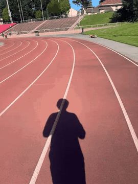
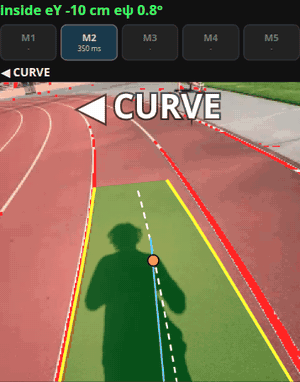

# Haptic Lane Guide

A haptic belt that helps blind runners stay in their lane on an athletics track without a sighted guide.
A chest-mounted iPhone watches the lane lines and tells a vibration belt which way to correct:
the motor's position says the direction, the pulse rate says how far off the runner is.

Built at Cal Hacks 13.0 (Oct 23-25, 2026).

<table>
  <tr>
    <td align="center"></td>
    <td align="center"></td>
  </tr>
  <tr>
    <td align="center">What the chest-mounted phone sees (jogging, real track)</td>
    <td align="center">The app on the same footage: locked lane, <b>◀ CURVE</b> cue, M2 pulsing</td>
  </tr>
</table>

## How it works

```
iPhone in the Bluefy browser (chest mount)                         Arduino UNO R4 WiFi (belt)
camera 30 fps ──┐
IMU ~60 Hz ─────┴─> lane detection -> lane tracking -> filter -> cue ──BLE──> pulse timing -> M1..M5
                                                                 <── ACK ───  300 ms watchdog
```

Everything runs on the phone; no laptop or network is needed while running.

1. **Line detection** (`web/lane/detector.js`, OpenCV.js): white paint is masked in HSV, projected onto
   the ground with the phone's attitude (gravity from the IMU), and searched for the lane direction.
   Lines become peaks of a lateral histogram in four distance bands (1-5.5 m ahead).
2. **Lane tracking** (`web/lane/tracker.js`): on Lock, the tracker takes the two lines around the
   runner and follows them frame to frame (sliding window + quadratic fit for curves). It gives the
   runner's lateral offset, heading and the curvature ahead.
3. **Filter** (`web/control/estimator.js`): Kalman filter on offset, lateral speed and heading, with
   the gyro as the prediction between camera frames.
4. **Belt cue** (`web/control/controller.js`): position and heading are averaged over the running
   stride and mapped to the belt's motors:

   | Motor | Meaning | Pulse period |
   |---|---|---|
   | M1 / M5 | big turn left / right | 350 ms |
   | M2 / M4 | small turn left / right | 600 ms |
   | M3 | centered, "heartbeat" (not fitted on our belt, so centered = no vibration) | 1000 ms |
   | M2 on a left bend | keep turning with the curve (announced by a double tap) | 800 ms |
   | M1 + M5 | stop (lane lost) | 300 ms |

   A new cue must persist briefly before it is sent and is then kept at least 1.5 s, so stride-by-stride
   noise does not reach the belt.
5. **Belt** (`firmware/lane_actuator_ble/`): the phone sends 5 motor levels (M1..M5) over Bluetooth LE at
   ~20 Hz; the R4 turns each level into 200 ms vibration pulses and stops every motor if no command
   arrives for 300 ms.

## Measured results

On real track footage (chest-mounted iPhone, recorded with `web/record.html`, replayed frame by frame
through the same code the phone runs):

| Jogging clip, time the runner was inside the lane | Before | Now |
|---|---|---|
| judged inside correctly | 83.4% | 96.2% |
| wrongly judged outside | 10.8% | 2.4% |
| lane lines matched | 44.9% | 90.0% |
| belt cue changes per minute | 390 | ~14 |
| left/right cue reversals | 43 | 0 |

- Real departures (4 in the clip) are cued within 0.0-0.5 s; 84% of the time outside the lane is cued.
- Track bends: curve guidance starts 0-0.5 s after the bend begins and covers 97.5% of bend time.
- Latency, camera frame to board: 46 ms median, 60 ms p95 (BLE round trip 55 ms). Lane processing
  takes ~3 ms per frame on the phone.

Known limits: the start/finish area, with many crossing and diagonal lines, can make the tracker
jump to the neighboring lane for a few seconds; white thresholds are tuned for daylight (they can be
changed on the page); the numbers come from three clips recorded on one day on one track.

## Using it

The pages need HTTPS (camera, motion sensors, Web Bluetooth) and are served by GitHub Pages. On the
iPhone use **Bluefy** (Safari has no Web Bluetooth).

| Page | What for |
|---|---|
| [The app](https://77qhtjd-bit.github.io/haptic-lane-guide/web/spike-ground.html) (`web/spike-ground.html`) | camera + lane overlay, Lock lane, Connect belt, motor test, run recording, tuning panel |
| [Belt check](https://77qhtjd-bit.github.io/haptic-lane-guide/web/runner-test.html) (`web/runner-test.html`) | manual M1-M5 buttons, BLE latency |
| [Recorder](https://77qhtjd-bit.github.io/haptic-lane-guide/web/record.html) (`web/record.html`) | record video + full-rate IMU on the phone, for development |
| [Replay](https://sunuk00.github.io/haptic-lane-guide/web/replay.html) (`web/replay.html`, `phone-ble-pipeline` branch) | desktop Chrome; needs a recorded clip (`.mp4` + `.json` from the recorder; our track clips are not in the repo) |

Without the phone mount the app still runs on a laptop with a webcam, but the lane geometry assumes
a chest-mounted phone looking at the ground.

Running: open `spike-ground.html` in Bluefy and tap **1. Connect belt** (once; it reconnects by
itself), **2. Start camera + motion**, stand in your lane and tap **3. Lock lane**. Two short taps on
the belt confirm the lock, and from then on the belt guides you (**Belt ON / PAUSED** to pause it).
Tap a motor in the belt preview to test it. The screen is kept on while running (otherwise set
Auto-Lock to Never). **Record clip** saves the run's video + IMU for the replay demo. Line color
(Vmin/Smax), camera height (default 1.5 m) and every rule are under **Advanced**, or in the address
(`?t_<key>=..` tracker, `?c_<key>=..` belt cue).

Replay demo: open `replay.html` in desktop Chrome, pick a recorded `.mp4` + `.json`, **Connect belt**,
and play; the screen shows the lane and belt cues while the real belt vibrates. On Linux, Chrome needs
`chrome://flags/#enable-experimental-web-platform-features` enabled for Bluetooth, and the phone must
let go of the belt first (it accepts one connection).

Development tools on the `phone-ble-pipeline` branch: `web/replay.html` plays a recorded clip through
the full pipeline in desktop Chrome (frame-by-frame mode, scoring against hand-marked departures, belt
preview, and it can drive the real belt for indoor demos); `laptop/` holds the transport spikes.

## Hardware

<!-- Hardware photo: docs/images/belt.jpg -->

- Arduino UNO R4 WiFi and coin vibration motors around the waist: M1, M2 on the left, M4, M5 on the
  right, switched from pins D2-D6 (or A1-A5, one `#define` in the sketch). The center motor M3 is in
  the protocol but not fitted on our belt (we ran out of budget), so "centered" is felt as silence.
- Coin motors need ~200 ms to be felt, which sets the pulse length.
- The R4's LED matrix shows one bar per motor while it pulses.
- iPhone in a chest mount at ~70° pitch, about 1.5 m above the ground.

Flashing (Arduino IDE or arduino-cli, needs the ArduinoBLE library):

```bash
arduino-cli core install arduino:renesas_uno
arduino-cli lib install ArduinoBLE
arduino-cli compile --fqbn arduino:renesas_uno:unor4wifi firmware/lane_actuator_ble
arduino-cli upload -p /dev/ttyACM0 --fqbn arduino:renesas_uno:unor4wifi firmware/lane_actuator_ble
```

BLE protocol, pin options and tuning notes: `docs/phone-pipeline.md`, `firmware/HANDOFF.md`.

## Repository

| Path | Contents |
|---|---|
| `web/lane/` | ground geometry, line detector, lane tracker |
| `web/control/` | Kalman filter, belt cue controller, BLE protocol + reconnecting link, tuning panel, audio cue |
| `web/spike-ground.html` | the phone app |
| `web/test/` | unit tests (`npm test`, Node 18+) |
| `web/vendor/` | OpenCV.js 4.10 |
| `firmware/lane_actuator_ble/` | belt firmware (UNO R4 WiFi, ArduinoBLE) |
| `docs/phone-pipeline.md` | measured transport results and the BLE protocol |
| `HACK.md` | team plan and status log |

Open-source libraries: OpenCV.js (Apache 2.0), ArduinoBLE (LGPL 2.1), Arduino LED Matrix library.
